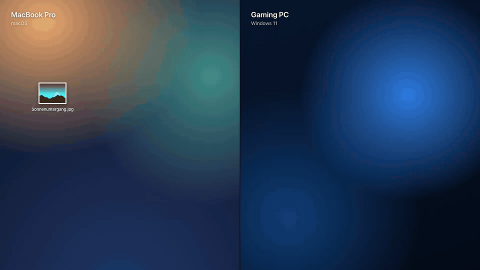
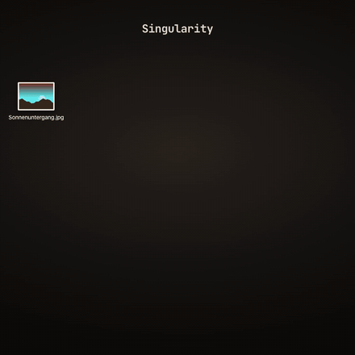
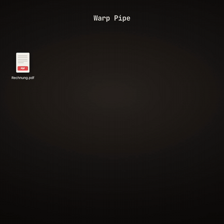
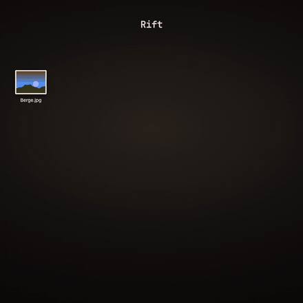
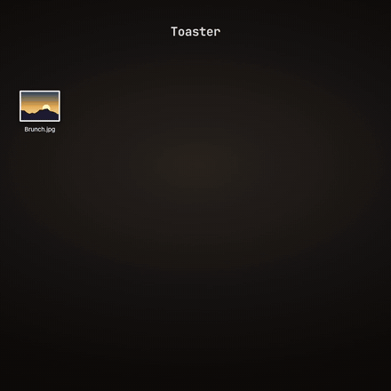
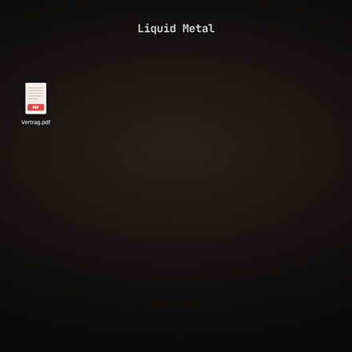
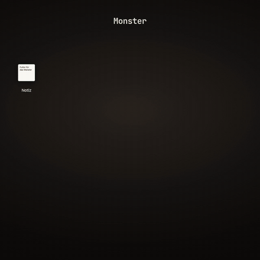
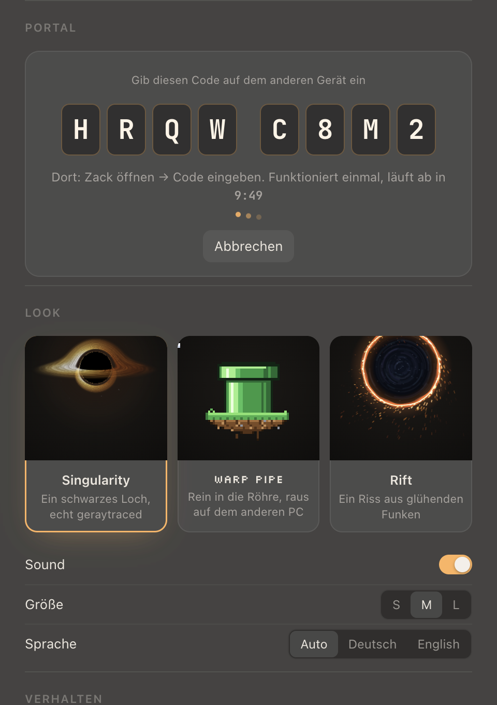
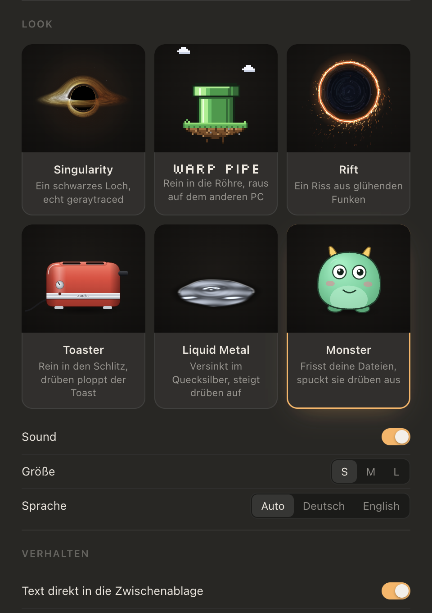

<p align="center">
  
</p>

<h1 align="center">zack.</h1>

<p align="center">
  <b>A portal between your computers.</b><br>
  Drop anything into it. It comes out on your other machine.
</p>

<p align="center">
  <a href="https://github.com/lennystepn-hue/zack/releases/latest"></a>
  
  
  <a href="LICENSE"></a>
</p>

---

Zack is a small widget that sits on your desktop. Drag a photo, a PDF, a whole folder or a bit of text onto it, and it gets pulled in and comes out again on your other computer: the photo is on that machine's clipboard, the file is in `Downloads/Zack`, the text is ready to paste. Mac to Windows, Windows to Mac, Mac to Mac, Linux to anything, and as many machines in one portal as you like.

No account, no cloud drive, no cable. Two computers link up once with an eight-character code, and from then on everything that crosses is end-to-end encrypted.

## Six ways to look at it

Every look has its own animation for taking something in and for handing it out, and its own sound, synthesized on the spot.

<table>
  <tr>
    <td align="center" width="33%"><br><b>Singularity</b><br><sub>A black hole, ray-traced per pixel. Light bends around it, files get stretched on the way in and come out of a white hole.</sub></td>
    <td align="center" width="33%"><br><b>Warp Pipe</b><br><sub>A green pipe on a floating island. Files turn into pixel sprites, and you can watch them bulge their way down the pipe.</sub></td>
    <td align="center" width="33%"><br><b>Rift</b><br><sub>A tear in the air, edged in molten sparks that drip with gravity. Files burn through the rim.</sub></td>
  </tr>
  <tr>
    <td align="center"><br><b>Toaster</b><br><sub>Your file gets branded onto a slice of bread, goes into the slot, and pops up over there with a ding.</sub></td>
    <td align="center"><br><b>Liquid Metal</b><br><sub>A puddle of mercury with real ripples. On arrival a column of metal rises and melts away.</sub></td>
    <td align="center"><br><b>Monster</b><br><sub>Eats your files, chews, burps. The one on the other side gets queasy and coughs them back up.</sub></td>
  </tr>
</table>

Switch looks any time from the tray menu or the settings. Each computer can wear a different one.

## Get it

Download the latest version from **[Releases](https://github.com/lennystepn-hue/zack/releases/latest)**:

| | |
|---|---|
| **macOS**, Apple Silicon (M1 and newer) | `Zack-…-mac-arm64.dmg` |
| **macOS**, Intel | `Zack-…-mac-x64.dmg` |
| **Windows** | `Zack-…-win-setup.exe`, or `Zack-…-win-portable.exe` to run without installing |
| **Linux** | `Zack-…-linux-x64.AppImage`, or the `.tar.gz` |

The builds are not code-signed yet, so the first launch needs one extra click. On macOS, right-click Zack in Applications and choose **Open** (if macOS calls the app damaged, run `xattr -cr /Applications/Zack.app`). On Windows, click **More info → Run anyway** in the SmartScreen dialog.

## Link two computers



1. On the first computer, Zack opens its settings by itself. Click **Open a new portal** and you get a code like `HRQW-C8M2`.
2. On the second computer, choose **Enter a code** and type it in, in any case, with or without the dash.
3. Both portals light up. That's it.

The code works exactly once and expires after ten minutes. Add a third or fourth machine the same way with **Add a device**. Removing a device in the settings gives everyone else a new key on the spot, so whatever the removed one kept is useless.

The app speaks English and German, following your system or the choice in the settings (the screenshots here are in German).

<br clear="right">

## Using it

- **Drop anything** onto the portal: files, folders, several at once, images straight out of a browser, selected text, links.
- **Send the clipboard** from anywhere with <kbd>⌥</kbd><kbd>⌘</kbd><kbd>Z</kbd> on a Mac, or <kbd>Ctrl</kbd><kbd>Alt</kbd><kbd>Z</kbd> on Windows and Linux. With the widget focused, a plain paste works too.
- **What arrives:** text and links go straight to the clipboard, images too (and into `Downloads/Zack`), files and folders land in `Downloads/Zack`. Links can open in the browser by themselves if you switch that on.
- **Hover** over the portal to see who is on the other end and the last five things that went through. Click one to open it, drag it out to drop it anywhere, right-click to copy it, show it in its folder, or cancel a transfer that is still running.
- **Move it** by dragging the portal itself. Only the portal catches the mouse; everything around it clicks through to whatever is underneath.
- **Click** the portal for quick actions (send clipboard, open received files, settings), **right-click** for the full menu.
- **Offline is fine.** Send something to a computer that is switched off and it arrives when that computer comes back, within a day.
- If Zack is hidden when something arrives, it shows itself for the animation and tucks itself away again.

<p align="center"></p>

## How it works

```
  your Mac                                                     your PC
  ┌──────────┐   encrypted 4 MB chunks    ┌───────────────┐    ┌──────────┐
  │  zack.   │ ─────────────────────────▶ │ Cloudflare R2 │ ─▶ │  zack.   │
  │          │                            │ (deleted on   │    │          │
  │          │ ◀── presence, envelopes ──▶│  arrival)     │    │          │
  └──────────┘      Durable Object        └───────────────┘    └──────────┘
                    one per portal
```

A small relay on Cloudflare passes things along: a Worker, one Durable Object per portal that knows which devices are online and keeps a mailbox for the ones that aren't, and R2 storage for the chunks while they are in flight. Large files stream: the other computer starts downloading the first chunk while the last one is still uploading.

## Privacy and security

- **End-to-end encrypted.** Everything is sealed on your computer with AES-256-GCM before it leaves, with a fresh key for every drop. File names, previews and texts are sealed too. The relay only ever sees encrypted bytes, their size and when they moved. The chunk count is sealed as well, so the relay can't cut a file short unnoticed.
- **Nothing is kept.** The encrypted chunks are deleted the moment the last recipient has them, typically within a second. Only a drop for a computer that is offline waits, for at most a day (texts up to 30 days), and a cleanup rule removes anything orphaned after two days.
- **Pairing without trusting the server.** The relay sees a slow hash of the code, never the code. The portal key travels inside an envelope sealed with a second derivation of it, and pairing is rate-limited.
- **Removed means removed.** Removing a device rotates the portal: the others move to a new room with a new key, handed over encrypted under the old one.
- **Safe on arrival.** Files from the other side are never opened automatically, a click on a program only shows it in its folder, folder archives can't write outside their target, and incoming file names are cleaned up.
- **A locked-down app.** Sandboxed renderers with context isolation, a strict content security policy, every message to the app's core checked for where it came from, no navigation, no pop-up windows. Portal keys live in the system keychain where one is available.

## Costs and limits

For personal use the relay runs inside Cloudflare's free tier: Workers and Durable Objects include 100,000 requests a day, R2 includes 10 GB of storage, and downloads from R2 cost nothing. A 1 GB video is about 500 requests. Because the relay is public by design, it accepts at most **10 GB of uploads per day** in total, rate-limits every address, and expires everything within two days.

## Run your own relay

Release builds talk to the author's relay. To have your own, deploy `worker/` to your Cloudflare account and build the app against it:

```bash
cd worker && npm install
npx wrangler r2 bucket create zack-portal-blobs
npx wrangler deploy
openssl rand -base64 48 | npx wrangler secret put ROOM_SECRET

cd ../app && npm install
ZACK_SERVER=https://<your-worker>.workers.dev npm run dist:mac
```

`DAILY_UPLOAD_GB` in `worker/wrangler.jsonc` sets the daily cap.

## Develop

```bash
cd worker && npm install && npm run dev        # the relay on :8787
cd app && npm install
ZACK_SERVER=http://127.0.0.1:8787 npm run dev   # the app against it
npm run dev:b                                   # a second instance with its own profile, to pair with
npm run stage                                   # every look in a browser with a fake other side: localhost:5199/stage.html
node scripts/e2e-core.ts [relay]                # end-to-end test: pairing, transfers, offline delivery
node scripts/e2e-rekey.ts [relay]               # removing a device locks it out
```

The app is Electron with electron-vite. `app/src/core` holds the transport and the crypto without any Electron in it, which is why the end-to-end tests run in plain Node. The looks live in `app/src/renderer/src/themes`, on a shared base that gives each of them the same beats (take in, emerge, present, dock) and leaves the drawing to them.

The animations in this README are the real widgets, scripted by `app/src/renderer/reel.html` and rendered frame by frame with Cuttle.

### Releases

Raise the version in `app/package.json`, then push a tag:

```bash
git tag v0.2.0 && git push origin v0.2.0
```

GitHub Actions builds macOS, Windows and Linux natively and publishes the release with all installers.

## License

MIT
